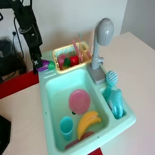

# 机器学习课程大作业（B 类）：OpenVLA-7B 轻量微调与 SimplerEnv WidowX 闭环评测

本项目完成一条完整的 VLA 工程链路：

1. 使用公开的 **OpenVLA-7B**（在 BridgeData V2 / WidowX 数据上预训练）；
2. 从 BridgeData V2 筛选任务相关子集并转换为 RLDS；
3. 用 **LoRA** 在子集上微调，保存 adapter、训练日志与数据统计量；
4. 在 **SimplerEnv WidowX Visual Matching** 的 T1/T2 上，对 Base 与 Final 各评测 10 个预先固定的初始状态；
5. 汇总成功率、B-SimplerScore，并结合视频分析。

> 本项目为 B 类（工程实践型），不要求 Final 一定优于 Base；重点是真实、可复现的完整流程与有证据的分析。

## 项目成员与分工

| 成员 | 学号 | 分工 |
|---|---|---|
| 胥昊天（组长） | 26213050409 | 项目统筹、环境/数据管线、LoRA 训练与最终评测、报告整合 |
| 曹奕伦 | 26113050003 | BridgeData 筛选与 RLDS 构建、训练日志与验证 loss 分析 |
| 徐厚泽 | 26113050327 | SimplerEnv 评测脚本、初始状态清单与逐 episode 结果汇总 |
| 彭泽宇 | 26213050317 | 视频采集与代表性 episode 分析、失败原因整理 |
| 刘翔 | 26113050287 | 模型/文献调研、复现文档与报告校对 |

## 1. 模型与合规性

| 项目 | 内容 |
|---|---|
| 基础模型 | `openvla/openvla-7b`（OpenVLA，7B） |
| 训练数据依据 | OpenVLA 在 Open X-Embodiment 上预训练，其中包含 BridgeData V2（WidowX 真机数据） |
| 参考 | OpenVLA 论文/模型卡：https://huggingface.co/openvla/openvla-7b |
| 微调模块 | LoRA（rank 32，`target_modules="all-linear"`） |
| 可训练参数 | 110,828,288 / 7,652,065,472（1.45%） |
| Final 形式 | LoRA adapter（约 484 MB），依赖上述 Base；加载方式见第 6 节 |

## 2. 仓库结构

```text
MLwork/
├── README.md
├── PLAN.md                  # 计划与进度
├── worklog.md               # 环境版本与操作时间线
├── constraints.txt          # torch/torchvision/numpy 版本锁
├── configs/
│   └── eval_states.json     # 预注册评测初始状态（Base/Final 共用）
├── scripts/
│   ├── env.sh
│   ├── download_bridge_subset.py
│   ├── bridge_subset_dataset.py
│   ├── build_rlds.py
│   ├── check_data.py
│   ├── train_openvla.py
│   └── evaluate_openvla.py
├── results/
│   ├── README.md            # 结果目录说明
│   ├── results.csv          # Base/Final 汇总
│   ├── episodes.csv         # 40 个 episode 明细
│   ├── eval_base.log
│   ├── eval_final.log
│   ├── videos/              # Base/Final × T1/T2 共 40 个
│   ├── train/               # train_log.txt, val_loss.csv
│   ├── analysis/            # dev_selection.csv, diagnostics_real_bridge.txt
│   └── archive/             # sharp/bare-prompt/ablation 原始记录
├── checkpoint_link.txt      # Final adapter 下载链接（提交时填写）
└── third_party/             # gitignore；按下方版本克隆
```

## 3. 数据

- 来源：BridgeData V2（WidowX），Hugging Face 镜像
  `IPEC-COMMUNITY/bridge_orig_lerobot`；原始数据中心为
  https://rail-berkeley.github.io/bridgedata/。
- 筛选：按语言指令选择勺子/毛巾、茄子、胡萝卜/盘子、绿黄方块叠放相关轨迹，
  每类最多 400 条，共 **1584 条轨迹**（3168 个文件，约 362 MB）。
- 每条轨迹只用主视角 `image_0`（256×256, 5 fps）+ 7 维 action + 8 维 state。
- 动作约定：`[x, y, z, roll, pitch, yaw, gripper]`，夹爪 1=张开、0=闭合。
- RLDS：按完整轨迹划分 train/val；train 1506 条、val 78 条，共约 1.4 GB。
- 字段：`observation.image_0`、`observation.state`、`action`、`language_instruction`。
- 归一化：Base 使用 OpenVLA 预训练的 `bridge_orig` 统计量；Final 使用训练子集统计量
  （保存于 run 目录的 `dataset_statistics.json`，推理时显式覆盖）。
- 训练/验证划分按轨迹进行，不存在同一轨迹相邻帧跨 split 的泄漏。



样本（episode 150，第 0 帧）：`instruction = "put eggplant on plate"`；
`action = [-0.0001, -0.0030, -0.0063, -0.0045, 0.0193, -0.0037, 1.0]`
（`x, y, z, roll, pitch, yaw, gripper`；gripper=1 表示张开）。

生成命令：

```bash
python scripts/download_bridge_subset.py --output data/bridge_subset/raw
python scripts/build_rlds.py --raw data/bridge_subset/raw --tfds-dir data/bridge_subset/tfds
python scripts/check_data.py --raw data/bridge_subset/raw --num 5
```

## 4. 环境

主要版本（完整记录见 `worklog.md`）：

| 组件 | 版本 |
|---|---|
| Python | 3.10.12 |
| PyTorch | 2.7.1+cu128（RTX 5090 / sm_120） |
| transformers / tokenizers | 4.40.1 / 0.19.1（OpenVLA 远程代码强校验） |
| timm | 0.9.10 |
| TensorFlow / TFDS | 2.15.0 / 4.9.4（protobuf 3.20.3） |
| SAPIEN | 2.2.2 |
| SimplerEnv | commit `eddb5690749a1e34267807c0f7b5eede323918d7` |
| ManiSkill2_real2sim | commit `ef7a4d4fdf4b69f2c2154db5b15b9ac8dfe10682` |
| OpenVLA | commit `c8f03f48af692657d3060c19588038c7220e9af9` |

注意事项：

- 5090 上必须使用 CUDA 12.8 的 PyTorch wheel；`torch 2.3.1`（OpenVLA 原始要求）不支持 sm_120。
- OpenVLA 原始代码强制 `flash_attention_2`，本项目在适配器中改为 `sdpa`。
- SAPIEN 渲染必须强制 NVIDIA Vulkan ICD：
  `VK_ICD_FILENAMES=/etc/vulkan/icd.d/nvidia_icd.json`。
- `mediapy` 需要 PATH 中有 ffmpeg；`venv_openvla/bin/ffmpeg` 已链接 imageio-ffmpeg 的二进制。
- OpenVLA 的官方 `bridge_orig` transform 会删掉第一帧（官方数据首帧为零动作）；
  LeRobot 版本已无该首帧，因此本项目注册了 `bridge_subset` transform，只做 gripper 二值化和动作重标定。

创建环境（简要）：

```bash
/usr/bin/python3.10 -m venv venv_openvla
venv_openvla/bin/pip install -U pip setuptools wheel
HTTPS_PROXY=http://127.0.0.1:7899 venv_openvla/bin/pip install \
  "torch==2.7.1+cu128" "torchvision==0.22.1+cu128" \
  --index-url https://download.pytorch.org/whl/cu128
venv_openvla/bin/pip install \
  "numpy==1.24.4" "scipy==1.12.0" "transformers==4.40.1" "tokenizers==0.19.1" \
  "timm==0.9.10" "sentencepiece==0.1.99" "peft==0.11.1" "accelerate==0.32.1" \
  "sapien==2.2.2" "gymnasium>=0.28.1,<1.0" tensorflow==2.15.0 \
  tensorflow_datasets==4.9.4 tensorflow-metadata==1.14.0 protobuf==3.20.3 \
  -c constraints.txt
venv_openvla/bin/pip install -e third_party/SimplerEnv/ManiSkill2_real2sim --no-deps
venv_openvla/bin/pip install -e third_party/SimplerEnv --no-deps
venv_openvla/bin/pip install -e third_party/openvla --no-deps
venv_openvla/bin/pip install -e third_party/dlimp_openvla --no-deps
```

## 5. 训练

```bash
source scripts/env.sh
WANDB_MODE=disabled venv_openvla/bin/torchrun --standalone --nnodes 1 --nproc-per-node 1 \
  scripts/train_openvla.py \
  --vla_path downloads/openvla-7b \
  --data_root_dir data/bridge_subset/tfds \
  --dataset_name bridge_subset \
  --run_root_dir checkpoints/openvla_lora/runs \
  --adapter_tmp_dir checkpoints/openvla_lora/adapters \
  --batch_size 2 --grad_accumulation_steps 4 \
  --max_steps 3000 --save_steps 3000 \
  --learning_rate 5e-4 --lora_rank 32 \
  --image_aug False --shuffle_buffer_size 100 \
  --run_id_note lora-r32-3000 > results/train/train_log.txt 2>&1
```

- 等效 batch size = 2 × 4 = 8；固定 3000 个优化步。
- 实际耗时约 48 分钟（RTX 5090，单卡）。
- 训练 loss 见 `results/train/train_log.txt`；Final adapter 约 484 MB。
- 本项目不保存合并后的 15 GB 全模型；Final = Base + LoRA adapter。

## 6. 评测

### 6.1 固定协议

- SimplerEnv `WidowX Visual Matching`；控制频率 5 Hz、仿真频率 500 Hz。
- T1：`PutSpoonOnTableClothInScene-v0`，`bridge_table_1_v1`，max 60 steps，
  指令 `put the spoon on the towel`。
- T2：`PutEggplantInBasketScene-v0`，`bridge_table_1_v2`，max 120 steps，
  指令 `put eggplant into yellow basket`。
- 初始状态：`configs/eval_states.json` 中的 object id **0–9**，Base/Final 完全一致；
  开发阶段使用 id 10–23，正式评测不使用。
- 成功判定：严格读取环境原生 `info["success"]`，不使用 `done`/`terminated` 代替。
- 图像预处理：Base/Final 统一使用高斯模糊 `sigma=1.5`（`configs/policy_preprocess.json`），
  用于缩小真实相机与仿真渲染的锐度差异；sigma 只在开发状态 object id 10–12 上选择，
  正式状态 0–9 未参与选择。模糊是 policy 的输入预处理，环境本身不变。
- 环境 seed 与模型 seed 分别记录在 `results/episodes.csv`。
- Base 与 Final 在独立进程中加载、评测。

### 6.2 命令

Base：

```bash
source scripts/env.sh
venv_openvla/bin/python scripts/evaluate_openvla.py \
  --model-label base \
  --checkpoint downloads/openvla-7b \
  --split formal \
  --blur-sigma 1.5
```

Final：

```bash
source scripts/env.sh
AD=checkpoints/openvla_lora/adapters/<adapter_dir>
RUN=checkpoints/openvla_lora/runs/<run_dir>
venv_openvla/bin/python scripts/evaluate_openvla.py \
  --model-label final \
  --checkpoint downloads/openvla-7b \
  --adapter-path "$AD" \
  --norm-stats "$RUN/dataset_statistics.json" \
  --split formal \
  --blur-sigma 1.5 \
  --episodes-csv results/episodes.csv \
  --summary-csv results/results.csv
```

### 6.3 加载 Final adapter

```python
from transformers import AutoModelForVision2Seq, AutoProcessor
from peft import PeftModel

base = AutoModelForVision2Seq.from_pretrained(
    "path/to/openvla-7b", torch_dtype=torch.bfloat16,
    low_cpu_mem_usage=True, trust_remote_code=True,
).cuda()
model = PeftModel.from_pretrained(base, "path/to/adapter")
```

`configs/eval_states.json`、`results/episodes.csv` 和视频共同构成逐 episode 记录。

**重要修正**：社区适配器最初直接把 `task_description` 传给 processor，漏掉了 OpenVLA 训练时的
prompt 模板：

```text
In: What action should the robot take to {instruction}?
Out:
```

修正后，我们重跑了 Base/Final 的 40 个正式 episode（当前 `results/episodes.csv`
即为修正 prompt 后的结果）。修正前的裸 prompt 结果归档在
`results/archive/bare_prompt/`，不用于最终结论。

## 7. 结果

最终协议：修正 OpenVLA prompt 模板 + Base/Final 统一使用高斯模糊 sigma=1.5。
sigma 只在**开发状态** object id 10–12（T1/T2）上选择，正式评测 object id 0–9 未参与选择。
配置见 `configs/policy_preprocess.json`。

| 模型 | 训练模块 | T1 成功数 | T2 成功数 | B-SimplerScore |
|---|---|---:|---:|---:|
| Base | 未进行本次微调 | 2/10（20%） | 2/10（20%） | 20.0 |
| Final | LoRA (r=32) | 1/10（10%） | 5/10（50%） | **30.0** |

Final − Base 变化：**+10.0 个百分点**（T1 −10.0，T2 +30.0）。

作为消融：同样修正 prompt、但不加模糊时，Base/Final 在正式 40 个 episode 上均为 0/10，
归档在 `results/archive/sharp_baseline/`；裸 prompt 的旧结果在 `results/archive/bare_prompt/`。

### 7.0 接口验证（重要）

在把 0 成功归因于模型能力之前，我们先验证了动作接口。用真实 BridgeData 的一帧图像和指令
喂给同一个 OpenVLA，与数据集中的真实动作对比（脚本 `scripts/check_openvla_real.py`，
输出 `results/analysis/diagnostics_real_bridge.txt`）：

| 帧 | 真实动作（前 6 维 + 夹爪） | OpenVLA 预测 |
|---|---|---|
| 0 | `[-0.0028,-0.0025,-0.0141,-0.0249,0.0361,0.0022, 1.0]` | `[-0.0029,-0.0024,-0.0140,-0.0250,0.0361,-0.0001, 0.9961]` |
| 10 | `[0.0040,0.0069,-0.0013,-0.0160,-0.0122,0.0048, 0.0]` | `[0.0040,-0.0024,-0.0005,0.0037,0.0006,-0.0097, 0.0]` |
| 19 | `[0.0004,-0.0218,-0.0218,0.0583,0.0519,0.1118, 0.0]` | `[0.0005,-0.0218,-0.0174,0.0043,0.0521,-0.0275, 0.0]` |

预测与真实动作非常接近，夹爪开/闭也一致。这说明 **prompt 模板、动作 token 解码、
反归一化和图像预处理都是正确的**。因此，SimpleEnv 中 0 成功不能解释为动作接口接错；
主因是真实 Bridge 图像与 SimplerEnv 渲染图像之间的域差异，以及 LoRA 微调规模有限。
我们在排查过程中还发现并修正了社区适配器漏掉 prompt 模板的问题（见 6.2 节）。

进一步定位到：仿真渲染图像比真实相机图像更锐利，模型在锐利仿真图上夹爪长期保持张开
（debug 值约 0.9961），而在真实 Bridge 帧上能正确输出闭合。加入 sigma=1.5 的高斯模糊后，
夹爪开始闭合，Base 在开发集上从 0/6 变为 2/6，正式评测从 0.0 提升到 20.0；Final 达到 30.0。
模糊是 **policy 的输入预处理**，环境、任务、初始状态均未改变，且 Base/Final 使用相同设置。

### 7.1 观察与分析

不加模糊时，Base 与 Final 在修正 prompt 后的正式评测中均为 0/10；加入 sigma=1.5 模糊后：
Base 为 T1 2/10、T2 2/10（B-SimplerScore 20.0），Final 为 T1 1/10、T2 5/10（30.0）。
这是“域差异”假设的直接证据：只改输入图像的锐度，就能让夹爪从长期张开变为闭合，
并在正式初始状态上产生成功 episode。

对成功/失败 episode 的逐帧观察（单 episode，不能外推为总体结论）：

- **Base 成功（T1，obj id 3，31 步）**：机械臂接近勺子、闭合夹爪、抬起并移动到毛巾上方，
  最终满足环境的“勺子在毛巾上”判定；视频见 7.2。
- **Base 成功（T2，obj id 2，23 步）**：夹爪抓起茄子并放入篮子，23 步完成。
- **Final 成功（T2，obj id 0，16 步）**：快速抓起茄子并放入篮子；Final 在 T2 的 5 次成功
  集中在较短的步数，说明微调对“茄子→篮子”有可观察的帮助。
- **Final 失败（T1，obj id 0）**：未能稳定抓住勺子；与 Base 相比 T1 略差（1/10 vs 2/10）。

可能的解释（部分有证据、部分尚未验证）：
1. 模糊带来的收益有直接证据：sharp→blur 使 Base 从 0/10 到 2/10、Final 从 0/10 到 5/10；
   但 sigma 只在 3 个开发状态上选择，存在过拟合风险；
2. Final 在 T2 提升明显（2/10 → 5/10）、T1 略低（2/10 → 1/10），可能与训练子集中
   茄子/篮子相关轨迹、以及 T1 勺子场景的多样性有关，但当前数据不足以证明因果；
3. LoRA 只更新 1.45% 参数、训练 3000 步；image_aug=True 的第二次训练在开发集上与原始
   Final 持平（均为 1/6），因此保留原始 adapter，增强训练只作为负向消融；
4. 每任务只有 10 个 episode，+10 pp 的总分变化和 T2 +30 pp 都不能视为稳定提升；
   0/10 与 2/10 的差异也可能来自评测方差。

补充：T1 数据质量对照。spoon_towel 的 400 条轨迹中，只有 188 条是真正的“勺子放到毛巾/布”，
179 条是移动布/毛巾等干扰任务。我们另外训练了一个只保留 188 条严格 T1 数据的 adapter
（其他类别不变，同 3000 步配置），在开发状态上（加 blur）：

| 模型 | T1 dev | T2 dev | T1 正式 |
|---|---:|---:|---:|
| Base + blur | 1/3 | 1/3 | 2/10 |
| 当前 Final（混合数据）+ blur | 1/3 | 0/3 | 1/10 |
| 严格 T1 adapter + blur | 1/3 | 2/3 | **0/10** |

T1 没有改善（dev 1/3 vs 1/3），且正式 T1 为 **0/10**，比当前 Final 的 1/10 还低；
说明 dev 上的那 1 次成功没有在正式状态上复现，更多是小样本波动。T1 的瓶颈不只是训练数据混杂，
还涉及任务精度与域差异；T2 的 2/3 可能是去除干扰后的副带收益，但 3 个 episode 方差大。
因此我们保留当前 Final，严格 T1 adapter 只作为数据质量消融，不进入正式结果。

补充：训练步数诊断。为了判断 T1 是否“训练不够”，我们从 3000 步延长到 **8000 步**，
并在 held-out val split 上比较 action-token loss：

| 模型 | val loss |
|---|---:|
| Base | 11.16 |
| Final 3000 步 | **3.17** |
| Final 8000 步 | **3.67** |

8000 步的训练 loss 更低（约 2.6），但验证 loss 反而升高；开发集上 T1 1/3、T2 0/3，
与 3000 步完全相同。因此 T1 的瓶颈不是“训练步数不够”，继续训练会过拟合；
我们保留 3000 步 Final，8000 步 adapter 仅作为消融（`results/archive/ablations/train_log_8000.txt`、
`results/train/val_loss.csv`）。

### 7.2 代表性视频

视频位于 `results/videos/`，覆盖成功与失败样例：

| 视频 | 模型 | 任务 | 结果 | 观察 |
|---|---|---|---|---|
| `results/videos/base/spoon_on_towel/episode_03_success.mp4` | Base | T1 | success | 抓起勺子并放到毛巾上（31 步） |
| `results/videos/base/put_eggplant_in_basket/episode_02_success.mp4` | Base | T2 | success | 抓起茄子放入篮子（23 步） |
| `results/videos/final/put_eggplant_in_basket/episode_00_success.mp4` | Final | T2 | success | 快速抓起茄子放入篮子（16 步） |
| `results/videos/final/spoon_on_towel/episode_00_failure.mp4` | Final | T1 | failure | 接近勺子但未稳定抓取/放置 |

## 8. 局限

- 正式评测每任务仅 10 次，成功率方差大；+10 pp 的总分变化和 T2 +30 pp 不能视为稳定提升。
- 模糊 sigma=1.5 只在 3 个开发状态上选择，存在过拟合开发状态的风险；更严格的做法是用更多
  开发状态或独立验证集选择，并在正式状态上只跑一次（本项目已保证正式状态未参与选择）。
- 不加模糊的 sharp 基线为 0/10；加入模糊后的提升有视频和 debug 动作证据，但仍需更大样本验证。
- image_aug=True 的第二次训练在开发集上与原始 Final 持平（1/6），未采用；只作为负向消融。
- T1 数据质量消融只在 3 个开发状态上评测，T1 未改善；不能据此断言数据清洗无效，
  但也不支持“T1 差只是因为数据混杂”的解释。
- 8000 步训练的 val loss（3.67）高于 3000 步（3.17），继续加步数会过拟合；
  增加训练量不是提升 T1 的有效方向。
- 训练子集来自 BridgeData V2 的任务相关筛选，与 SimplerEnv 的物体/场景分布仍有差异。
- 单次训练、单一种子；没有做多随机种子或多数据规模消融（B 类不要求）。
- Base 使用预训练 `bridge_orig` 统计量，Final 使用训练子集统计量；这是训练/推理一致性的
  工程选择，但也意味着两者的反归一化参数不完全相同。
- 由于共享 GPU 的 CUDA 状态问题，评测固定在 GPU 0 上串行执行；这不影响协议一致性。

## 9. 复现与提交

- 环境版本、命令、初始状态清单、逐 episode CSV、视频和训练日志均已放入仓库。
- 公开代码仓库：https://github.com/xht03/2026ML
- 实验报告：`report/REPORT.pdf`（6 页，含数据样本、接口验证、案例分析和参考文献）。
- Final adapter 下载链接：见 `checkpoint_link.txt`。
- 基础模型：`openvla/openvla-7b`。
- 依赖与版本：见 `worklog.md`。
- 代表视频清单：`video_links.md`。
- 提交前待办（组员、仓库、checkpoint 上传）：见 `SUBMISSION.md`。
